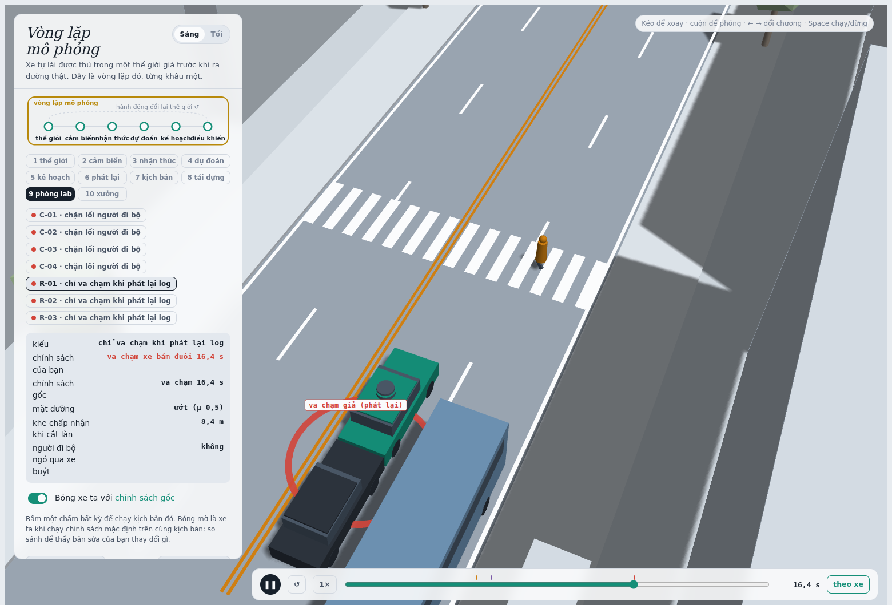
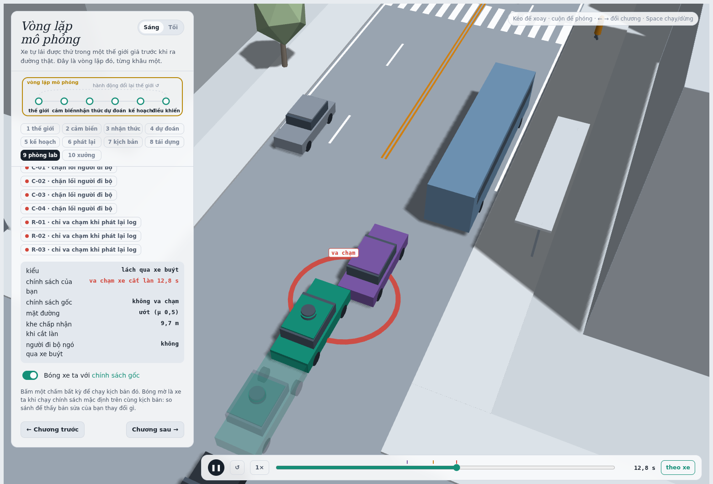
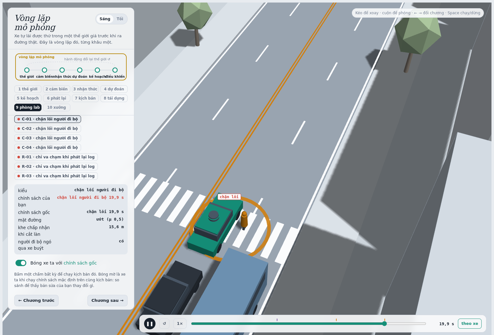
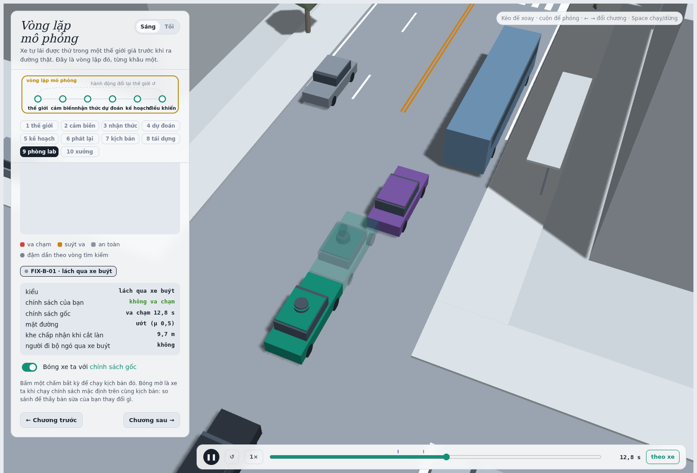
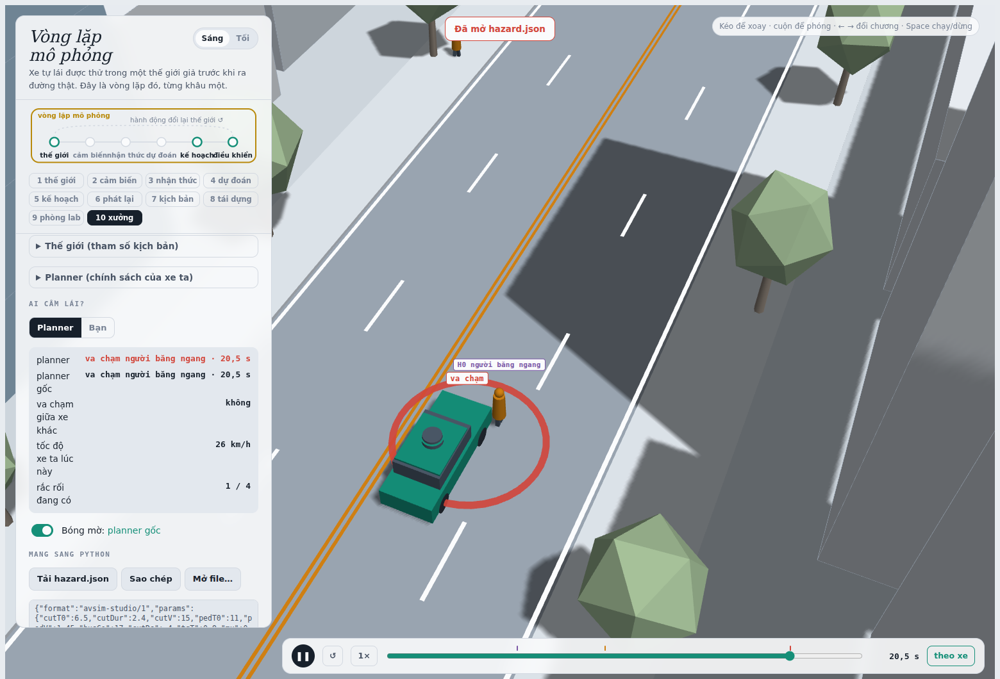

MSSV: 202602927

# Lab 11 · Scenario Forge — báo cáo

**Sinh viên: Đặng Đỉnh Đoàn — mã đầy đủ: 2A202602927.** Dòng đầu dùng phần số `202602927` theo định dạng bắt buộc của `run_all.py`; đây cũng là mã dùng để sinh toàn bộ bằng chứng.

**Thị trấn B**, xác suất đường ướt 0,30, người đi bộ ngó qua xe buýt 0,85, xe chuyển làn phanh sau khi nhập làn 0,15; trung vị khe chấp nhận 12 m. Nguồn: `meta.json: _run.town`, `avsim/space.py: VARIANTS`. Seed trong `meta.json: seeds`: MC **789246541**, search **2300353666**, TEST **4280786481**. Tất cả bước nộp dùng ngân sách đầy đủ, `quick = false`, không đổi seed, lõi mô phỏng hay danh sách ứng viên cho sẵn.

Các đường dẫn JSON dưới đây thuộc `evidence/`. `observations.json` và `policy_counterexample.json` là **lần phát lại bổ sung** để giải thích diễn biến; không dùng chúng để chọn policy. Ảnh chụp trực tiếp trình xem đi kèm lab. Thời gian, kịch bản và mã kiểm tra ảnh nằm trong `shots/manifest.json`.

## 1. Phát lại log có trung thực không? (A)

`replay.json`: lấy **400** kịch bản, bỏ **3** log có người lái va chạm, còn **397**.

| Thế giới | Tổng thất bại | front | rear | side |
|---|---:|---:|---:|---:|
| Phát lại log | 102 | 0 | 88 | 14 |
| Tác nhân phản ứng | 1 | 1 | 0 | 0 |

Nguồn: `replay.crashes`, `replay.contact`, `reactive.crashes`, `reactive.contact`; **0** kịch bản va chạm ở cả hai (`crash_in_both`). Các loại không có khóa trong JSON được ghi là số đếm 0, không phải kết luận xác suất bằng 0.

88/102 va chạm phát lại là từ phía sau. Planner phanh khác thời điểm người lái ghi log; TG vẫn chạy đúng quỹ đạo cũ nên không phanh đáp lại vị trí mới của ego. Đây là lỗi của phản thực trên log, không chứng minh planner bị đâm đuôi trong giao thông biết phản ứng. Va chạm phía sau trong thế giới phản ứng, nếu có, vẫn là thất bại thật.

Ví dụ `replay_only[0]`: **scenario 4**, export thành **R-01**. Đường ướt, `tgT = 0,6697 s`; lúc **16,4 s**, TG chạm đuôi ego (`kind=contact`, `fake=true`). Cùng tham số trong thế giới phản ứng không có sự kiện và TTC nhỏ nhất là **2,46275 s**. Nguồn diễn biến: `observations.json: runs.R-01`, phát lại từ chính `viewer.json`.



## 2. Kịch bản bất khả thi (B)

`is_feasible` loại khi bất kỳ điều kiện sau vi phạm:

| Luật | Căn cứ |
|---|---|
| `(π/cutDur)² × 3,5/2 ≤ μg` | Gia tốc ngang cực đại của chuyển làn cosine không vượt lực bám. |
| `cutBrake ≤ μg` | Không yêu cầu lực phanh dọc vượt lực bám. |
| `pedV ≤ 2,5 m/s` | Miền mô hình là người đi bộ; tốc độ lớn hơn thuộc hành vi chạy chưa mô hình hóa. |
| `0 < cutV ≤ 22 m/s` | Xe nhập làn đi tiến và nằm trong miền tốc độ của thị trấn. |

`g = 9,81 m/s²`: giới hạn bám **4,905 m/s²** khi ướt, **7,848 m/s²** khi khô. Hàm cũng loại thời lượng chuyển làn không dương và đầu vào không hữu hạn. Ngưỡng 2,5 và 22 là giới hạn mô hình, không phải định luật cấm người thật chạy hay xe chạy nhanh hơn.

`hunt.json: <mode>.infeasible`: bus_bypass **0**, cut_in **8**, crosswalk_block **21**, rear_ended **23**, trên **2.400** đề xuất/cuộc săn. **rear_ended** sinh nhiều mẫu không khả thi nhất (khoảng 0,96%). CEM ưu tiên khoảng cách nhỏ, đổi làn nhanh, tốc độ/phanh cực đoan vì chúng có điểm nguy hiểm cao. Bỏ lọc sẽ đẩy xác suất thất bại lên bằng chuyển động ngoài miền vật lý/mô hình; q cũng dễ co về các vùng ấy. Mẫu không khả thi không được mô phỏng hay đưa vào elite.

## 3. Monte Carlo cho biết gì? (C1)

`mc.json`: **k = 5**, **n = 3.000**, **p̂ = 0,001666667** (0,166667%), khoảng Wilson 95% **[0,0007120934; 0,0038958726]**. Cả 5 là `bus_bypass`; **18** đề xuất không khả thi. Theo runner, mẫu số vẫn là 3.000 lần rút tự nhiên: đo sự kiện thất bại trong miền khả thi trên phân phối gốc, không lấy lại mẫu cho đủ 3.000 lần chạy khả thi.

Muốn nửa bề rộng khoảng 95% bằng 20% của p, xấp xỉ nhị thức cho `n ≈ 1,96²(1−p)/(0,2²p) ≈ 96/p`. Với p̂, cần khoảng **57.600** lần rút; dùng hệ số 96,04 cho **57.624**, hiệu chỉnh `(1−p)` cho **57.528**. Đây là dự toán từ p̂ còn rất nhiễu, không bảo đảm Wilson thực tế đạt đúng độ rộng ấy.

`cut_in`, `crosswalk_block`, `rear_ended`, `other` đều chưa xuất hiện. Mỗi kiểu có **cận trên Wilson 0,0012788957** (`per_mode.<mode>.hi`); không báo xác suất thật bằng 0. Quy tắc ba cho xấp xỉ **3/3.000 = 0,001**. CEM vẫn tìm được crosswalk_block ở câu 5, nên không nhìn thấy trong MC không có nghĩa là không tồn tại.

## 4. Importance sampling, ESS và suy biến (C3)

Nguồn bảng: `estimate.json: seeds[s].per[mode]`. Mỗi hàng **n = 600**, q = 0,8·CEM + 0,2·tự nhiên. Ước lượng là `mean(exp(logw) × y)`, không tự chuẩn hóa bằng tổng trọng số. ESS là ESS của toàn bộ trọng số, không phải số va chạm hữu hiệu.

| Kiểu | Seed | p / cận khi chưa thấy | hits | ess | top_share |
|---|---:|---:|---:|---:|---:|
| bus_bypass | 0 | 5,883659e−4 | 68 | 138,483 | 0,160148 |
| bus_bypass | 1 | 8,421086e−4 | 64 | 118,038 | 0,299448 |
| bus_bypass | 2 | 9,682107e−4 | 70 | 115,597 | 0,113295 |
| cut_in | 0 | chưa thấy; cận trên 0,025 | 0 | 109,488 | 0* |
| cut_in | 1 | chưa thấy; cận trên 0,025 | 0 | 131,767 | 0* |
| cut_in | 2 | chưa thấy; cận trên 0,025 | 0 | 125,099 | 0* |
| crosswalk_block | 0 | 5,649221e−7 | 57 | 123,515 | 0,226760 |
| crosswalk_block | 1 | 2,375686e−6 | 70 | 124,868 | **0,701074** |
| crosswalk_block | 2 | 1,033119e−6 | 78 | 106,105 | 0,159843 |
| rear_ended | 0 | chưa thấy; cận trên 0,025 | 0 | 124,745 | 0* |
| rear_ended | 1 | chưa thấy; cận trên 0,025 | 0 | 106,327 | 0* |
| rear_ended | 2 | chưa thấy; cận trên 0,025 | 0 | 127,251 | 0* |

`*` top_share được runner ghi 0 khi không có hit: đó là giá trị quy ước, không phải dấu hiệu ước lượng tốt. Trường p thô bằng 0 ở các hàng này phải đọc kèm `upper_zero_hits = 3/(0,2×600) = 0,025`. **Không dùng 3/ESS**: ESS không đếm số phép thử độc lập có thể bắt gặp sự kiện.

Bus_bypass khác khoảng **1,65 lần** giữa các seed; crosswalk_block khác **4,21 lần**. Riêng crosswalk seed 1, một mẫu mang **70,1%** ước lượng: dù có 70 hit, phần lớn tổng trọng số va chạm do một mẫu quyết định, khiến khoảng chuẩn theo SE dễ quá tự tin. top_share thấp cũng không phát hiện được vùng thất bại bị q bỏ sót hoàn toàn.

| Seed | `total` | `lo` | `hi` do runner xuất |
|---|---:|---:|---:|
| 0 | 5,889308e−4 | 2,754784e−4 | 2,181279e−3 |
| 1 | 8,444843e−4 | 2,910933e−4 | 2,676771e−3 |
| 2 | 9,692438e−4 | 5,632611e−4 | 2,654122e−3 |

Trung vị tổng **8,444843e−4**, xấp xỉ một nửa MC. Khoảng rộng chồng nhau nhưng chưa chứng minh hai phương pháp khớp chính xác: riêng bus_bypass seed 0 có hi khoảng **9,018181e−4**, thấp hơn p̂ MC. Bỏ sót vùng thất bại và trọng số hiếm vẫn đáng lo.

`budget = 16.800 = 4×(8×300 + 3×600)`: **9.600** mẫu tìm kiếm và **7.200** mẫu ước lượng, chưa cộng MC 3.000 để đo other. MC cần khoảng **113.726** lần để nhắm ±20% nếu lấy trung vị IS làm p, khoảng 6,77 lần ngân sách IS. Nhưng **IS hiện chưa đạt ±20%**: nửa bề rộng chuẩn của tổng khoảng **53,2%, 65,5%, 41,9%** theo seed. So cùng SE thực nghiệm của phần đã quan sát, MC cần khoảng **23.013, 10.585, 22.569** lần; không có lợi thế cố định cho mọi seed. Phép tính bổ sung: `observations.json: stats`.

`other` lấy từ **MC**, `other.k = 0`, `n = 3.000`, cận Wilson **0,0012788957**. Đây là phần dư của phân hoạch, chưa có chuỗi sự kiện/điểm nguy hiểm riêng đáng tin để săn. Bỏ nó làm tổng thiếu một phần. Một giới hạn của file có sẵn: `total.hi` cộng bất định SE và cận other, **chưa cộng cận zero-hit của cut_in/rear_ended**. Không đọc cột này thành chứng nhận 95% toàn bộ rủi ro; hai kiểu chưa thấy vẫn phải báo cận riêng như trên.

## 5. Các kiểu thất bại (C2 + 3D)

| Cuộc săn | `found` trong hunt.json | Không khả thi |
|---|---|---:|
| bus_bypass | bus_bypass: 188 | 0 |
| cut_in | bus_bypass: 39; chưa tìm thấy cut_in | 8 |
| crosswalk_block | crosswalk_block: 76; bus_bypass: 2 | 21 |
| rear_ended | crosswalk_block: 14; bus_bypass: 6; chưa tìm thấy rear_ended | 23 |

Đây là số đếm trên đề xuất CEM, **không phải tần suất tự nhiên**. Trong hai ảnh C2, xe đặc chạy policy gốc đã sinh thất bại, bóng mờ chạy policy chọn; ảnh so sánh ở câu 6 đặt policy gốc làm bóng mờ. Tìm được hai kiểu:

**B-01 — bus_bypass, t = 12,8 s.** C2 gặp xe buýt dừng ở làn bên, chờ khe rồi lấn sang làn ego để lách. Planner nhận xe lấn làn là leader khi đủ gần theo phương ngang; đường ướt làm phanh muộn không đủ. Tại tiếp xúc, C2 ở **x = 95,806 m**, **v = 0,226 m/s**, ego **v = 2,341 m/s**: `contact`, loại `front`, đúng điều kiện bus_bypass. Nguồn: `observations.json: runs.B-01`.



**C-01 — crosswalk_block, t = 19,9 s.** P1 bắt đầu đi lúc **14,9 s**, có ngó qua bus (`pedLook = 1`) nhưng chấp nhận khe ngắn **0,9675 s**. P1 bị che với ego từ **8,75 tới 15,8 s**, nên ego chưa thấy lúc người bắt đầu đi. Ego phanh trên đường ướt rồi dừng ở **x = 121,228 m**: thân dài 4,6 m phủ vạch **x = 122 m**. P1 đứng lại tại **z = 3,446 m** vì thân ego chắn lối. Đây là `kind=block`, **không phải người đi xuyên vào xe**; cả hai đứng yên tại khung hình thất bại. Nguồn: `observations.json: runs.C-01`, `viewer.json: C-01`.



Không tìm thấy cut_in hay rear_ended. IS cũng không có hit nhưng cận mỗi kiểu còn **0,025**, nên bằng chứng về sự vắng mặt rất yếu. Cuộc săn cut_in tìm toàn bus_bypass; cuộc săn rear_ended tìm các kiểu khác. Chỉ một cuộc săn chung dễ co về bus_bypass và mất đa dạng, nên cần điểm nguy hiểm/đề xuất riêng và kiểm tra nhãn thực của va chạm.

## 6. Sửa planner (E + bóng mờ 3D)

Chọn **`{"cutinLat": 3.0}`**, tăng ngưỡng nhận xe lấn làn từ **2,15 lên 3,0 m**; núm khác mặc định. `choose_policy` lọc progress ≥95% baseline rồi xếp theo `fail_hi` TRAIN, hòa thì chọn progress cao hơn. Ngưỡng TRAIN **206,4944 m**. Ứng viên 3,0 thắng 3,3 nhờ progress TRAIN nhỉnh hơn; không dùng TEST để chọn hay thêm ứng viên.

| Mẫu / policy | fail | fail_hi_seen | fail_hi | progress (m) | harsh (khung hình/kịch bản) |
|---|---:|---:|---:|---:|---:|
| TRAIN gốc | 7,470854e−4 | 1,211718e−3 | 1,211718e−3 | 217,362555 | 7,742188 |
| TRAIN chọn | 1,808724e−6 | 4,440338e−6 | 4,440338e−6 | 217,395097 | 7,218750 |
| TEST gốc | 5,583874e−4 | 8,125152e−4 | 2,091411e−3 | 214,295077 | 8,342667 |
| TEST chọn | 4,049513e−7 | 7,850098e−7 | **3,877968e−2** | 214,242969 | 7,885000 |

Nguồn: `fix.json: baseline_train`, `chosen`, `baseline_test`, `chosen_test`. `harsh` đếm **khung hình a < −3 m/s²**, không đếm các đợt đạp phanh riêng. Progress chỉ tính tới thất bại đầu tiên. TEST giảm progress khoảng **0,0243%**, trong giới hạn 5%.

TRAIN gắn `unseen=[bus_bypass]` cho lựa chọn: 0 hit trên mẫu nhắm policy cũ chỉ giúp sàng lọc. TEST dùng seed mới, tập tự nhiên mới **3.000** kịch bản và săn lại dưới từng policy. Lựa chọn vẫn không thấy bus_bypass nên cộng **0,0375 = 3/(0,2×400)**, cộng cận va chạm khác **0,0012788957** và hi crosswalk **7,850098e−7**, ra `fail_hi = 0,0387796807`. Ngân sách chưa đủ chứng nhận một kiểu biến mất, nên cận này lớn hơn cả fail bản gốc. Không gọi mức giảm ước lượng điểm là cải thiện an toàn đã được chứng nhận; cần khoảng **15.000** mẫu/kiểu để hạ cận zero-hit xuống 10⁻³.

Ảnh dùng `viewer_comparison.json`: bản xem bổ sung sao nguyên tham số **B-01** từ `viewer.json`; xe đặc chạy policy chọn, **bóng mờ chạy policy gốc**. Tại **12,8 s**, gốc chạm C2 còn bản sửa giảm tốc từ xa và không có sự kiện suốt 24 s. Giữ riêng file export chuẩn, không đổi tham số kịch bản để tạo ảnh.



Núm nghe an toàn hơn: hạ `cautionV` xuống **5 m/s**. `fix.json: table[0]`: TRAIN fail **0,001226212**, lớn hơn baseline **0,000747085**, progress chỉ **173,104 m** nên bị loại. Bus_bypass có `top_share = 0,96056`, nên riêng mức tăng ước lượng chưa vững. Có phản ví dụ tất định trong `policy_counterexample.json`, mẫu TRAIN **130**: baseline không va chạm, nhưng cautionV=5 chạm C2 lúc **13,85 s**. Tại thời điểm tiếp xúc **13,85 s**, C2 ở z≈**4,474 m** với baseline, nhưng z≈**3,195 m** với ego chậm hơn; ego gốc đã tới x≈101,459 m, còn ego chậm mới ở x≈91,258 m. Ego lùi lại tương đối mở khe phía sau, C2 lấn nhiều hơn và ego còn cạnh C2 khi xe này gần dừng trước bus. Thế giới phản ứng lại việc giảm tốc; giảm một núm không bảo đảm giảm mọi thất bại.

## 7. Từ mô phỏng ra đường thật

Ba giả định cần thay bằng dữ liệu, không chỉ khớp lại một xác suất tổng:

| Giả định tại B | Dữ liệu cụ thể để thay | Hướng sai lệch |
|---|---|---|
| `cutGap` log-normal, trung vị 12 m, độc lập nhiều biến khác | Camera trên cao tại trạm bus và dashcam hiệu chuẩn: khe được nhận/bị từ chối, tốc độ tương đối, thời gian chờ, vị trí bắt đầu nhập làn; phân tầng theo mưa/mật độ. | Nếu khe thật nhỏ hơn hoặc nhiều người chen gấp, mô hình thường đánh giá thấp bus_bypass; phải đo cả phụ thuộc giữa khe và thời lượng chuyển làn. |
| `pedLook ~ Bernoulli(0,85)`, `pedGap` trung vị 4,5 s | Video trạm bus mã hóa hướng đầu, người bước ra, vị trí bị che, khe thời gian nhận/từ chối; ghép camera hai phía để không bỏ sót người bị bus che. | Nếu ít người ngó hơn hoặc khe nhận ngắn hơn giả định, số lần bước vào xung đột và crosswalk_block có thể bị đánh giá thấp; tác động tổng phải mô phỏng lại vì ego cũng phản ứng. |
| Đường ướt 30%, μ chỉ 0,5 hoặc 0,8 | Nhật ký chuyến ghép mưa/trạng thái mặt đường; đo giảm tốc cực đại bằng IMU/ABS trên đường thử có kiểm soát với đúng lốp, tải, mặt đường. | Nếu μ thật thấp hơn 0,5 hoặc ướt thường xuyên hơn, khoảng dừng dài hơn, rủi ro phanh muộn thường cao hơn dự báo. Bám tốt hơn cho xu hướng ngược lại. |

Đây là đề xuất dữ liệu cho chính tuyến vận hành, chưa phải dữ liệu đã thu. Nghiên cứu [FHWA về vị trí băng ngang](https://www.fhwa.dot.gov/publications/research/safety/13099/index.cfm) xem xét vị trí trạm bus và nhiều yếu tố môi trường: cần phân tầng theo địa điểm thay vì chuyển nguyên prior thị trấn giả ra đường thật.

## 8. Giới hạn

1. Một phố cố định, **24 s**, bước **0,05 s**: không cho xác suất của hành trình dài, tuyến có giao lộ phức tạp, hay sự kiện sau cửa sổ quan sát. `block` là thất bại phục vụ người đi bộ, không đồng nghĩa chấn thương.
2. Người lái là IDM và vài luật chấp nhận khe; ego chạy theo làn/phanh. Thiếu ý định đa dạng và né ngang thực tế. Bộ lọc gia tốc dọc/ngang chưa xét đầy đủ vòng tròn ma sát khi vừa phanh vừa đổi làn.
3. Trạng thái chính xác, che khuất hình học đơn giản; mưa chủ yếu đổi μ. Thiếu lỗi phân loại người, trễ nhận thức/điều khiển, suy giảm camera/LiDAR tương ứng hình ảnh mưa trong viewer. Xác suất này không chứng nhận hệ cảm biến thật.

Thêm một tuần: thu video băng ngang/cắt làn tại trạm bus để thay ba prior câu 7, bổ sung phân phối trễ cảm biến/phanh, rồi đo nhiều seed trên TEST khóa trước. Tăng ngân sách kiểu unseen tới ít nhất **15.000** mẫu/kiểu; theo dõi sai số theo batch và tìm vùng thất bại mới thay vì chỉ co CEM sâu hơn vào ví dụ cũ.

## 9. Rắc rối tự thiết kế (G + chương 10)

**Tình huống:** H0 từ lề Nam băng ngang **ngoài vạch**, x=165 m, v=1,5 m/s, bắt đầu khi ego còn cách 45 m. Cảnh `avsim-studio/1` mở/xuất lại được trong chương 10, giữ nguyên JSON (`shots/manifest.json: studio_roundtrip_equal`). `mine.json: exact.planner`: **ego–H0 lúc 20,5 s**. Người không chạy, không đặt chồng xe từ đầu.

**Vì sao thử:** logic dự đoán đến vạch xử lý riêng P1, còn H0 ngoài vạch chỉ thành chướng ngại khi lọt hành lang ngang. Người đang từ lề tiến vào đường có thể cần được dự đoán trước thời điểm đó. Bản sửa cutinLat nhắm xe nhập làn nên không trực tiếp sửa dự đoán người ngoài vạch.

**Dải quét:** `hazard.json: why` ghi căn cứ từng khoảng. x ∈ **[155;195] m** nằm sau vạch x=122 m và trong vùng chạy 24 s. v ∈ **[1,1;1,8] m/s** thuộc dải đi bộ thông thường [FHWA 2004, chương 2](https://www.fhwa.dot.gov/publications/research/safety/04091/02.cfm) mô tả. Từ z=9,2 tới hành lang z=3,65 m cần đi 5,55 m; chia tốc độ trên được **3,08–5,05 s**. Ego ở 12,5 m/s đi khoảng **38,5–63,1 m**, nên quét trigger **[38;65] m**, gồm hai phía thời điểm xung đột. Đây là thiết kế stress-test, không phải phân phối hành vi đo ngoài đời.

**Exposure:** **0,02 = 1/50** là prior thí nghiệm: tối đa một H0/chuyến, một chuyến có H0 trên 50 chuyến. Chưa có dashcam thực địa để đo tần suất này; **không coi nó là số quan sát hay tần suất tai nạn ngoài đời**. Sau này đếm đúng kiểu gặp H0 chia số chuyến trên tuyến, theo giờ/thời tiết. [FHWA về exposure](https://www.fhwa.dot.gov/publications/research/safety/pedbike/11043/index.cfm) giải thích vai trò số lần băng ngang/tương tác; tỷ lệ tử vong không cung cấp exposure/chuyến cho bài này.

**Quét trong giao thông B**, `mine.json`: đề xuất **1.500**, loại **11**, giữ **1.489**, `accepted = 0,9926667` (**99,2667%**); không chồng thân lúc đầu. Xác suất có điều kiện trên H0 và các biến thể khả thi của dải quét.

| Trường | Policy gốc | Chọn cutinLat=3 |
|---|---:|---:|
| n | 1.489 | 1.489 |
| crashes | 134 | 133 |
| avoidable, phanh tối đa ngay khi thấy | 134 | 133 |
| unavoidable | 0 | 0 |
| unattributed | 0 | 0 |
| low_speed (đã nằm trong các loại trên) | 2 | 0 |
| avoidable_foreknown | 134 | 133 |
| P(lỗi planner \| H0) | 0,08999328 | 0,08932169 |
| Wilson 95% | [0,07649309; 0,10560365] | [0,07587191; 0,10488511] |
| Tần suất/chuyến, exposure=0,02 | 0,001799866 | 0,001786434 |
| Cận trên/chuyến, chỉ bất định đếm | 0,002112073 | 0,002097702 |

0 unavoidable/unattributed là **số đếm**, không chứng minh xác suất bằng 0. `low_speed` là cờ bổ sung, không cộng thêm vào crashes. Hai policy lệch **1/1.489** trường hợp, khoảng Wilson gần trùng: chưa có bằng chứng cải thiện đáng kể cho H0. `avoidable_foreknown` bằng avoidable: trong va chạm quan sát được, biết từ lúc bắt đầu dù bị che không cứu thêm vụ nào; không kết luận che khuất vô hại cho tình huống khác.

Theo prior exposure, lỗi H0 gốc khoảng **1,80e−3/chuyến**, còn bus_bypass IS **5,88e−4–9,68e−4** mỗi lượt tự nhiên (trung vị **8,42e−4**, `estimate.json`). Nếu quy ước chuyến là một lượt lab tương ứng, H0 khoảng **2,14 lần** trung vị bus_bypass. So sánh chỉ đúng trong mô hình/prior này: 24 s không tự động là một chuyến ngoài đời. Nếu exposure đổi từ **0,005 đến 0,05**, tần suất H0 gốc thành **4,50e−4 đến 4,50e−3**, có thể thấp hoặc cao hơn bus_bypass. Wilson không bao gồm bất định exposure/sai lệch mô phỏng.

**Phân loại:** avoidable là cùng planner/thế giới trước đó, nhưng phanh ở giới hạn lốp ngay khung hình đầu H0 vừa hoạt động vừa nhìn thấy thì tránh được mọi va chạm ego. Unavoidable là cách phanh ấy vẫn không cứu; unattributed là không có hazard phù hợp đã hoạt động trước tiếp xúc. Không gộp cả ba thành lỗi planner.

**Chuẩn lạc quan:** oracle nhận biết tức thời và phanh tối đa, nên avoidable **đếm nhiều hơn** số vụ planner có trễ/bất định thực tế tránh được. Ngược lại, chỉ thử phanh mà không né ngang **bỏ sót** vụ có thể tránh bằng đánh lái. Hai hướng sai lệch cùng tồn tại.



**Tự lái:** chưa có thí nghiệm lái tay được ghi nhận; file giữ `ego=planner`, không có `egoAcc`. Không nhận kết quả oracle là thành tích tự lái của sinh viên. Trong cảnh chính xác, H0 bắt đầu và nhìn thấy lúc **16,3 s**; phanh oracle từ đó tránh tiếp xúc **20,5 s** (`observations.json: hazard_exact`).

**Cách sửa đề xuất:** dự đoán giao cắt cho **mọi người đi bộ**, không chỉ P1 ở vạch cố định: chiếu quỹ đạo từ lề, xét thời gian cùng chiếm hành lang, giảm tốc trước khi người lọt ngưỡng ngang 1,9 m; giữ điểm dừng trước đường băng ngang với biên theo μ và độ trễ. Vùng bị che cần giới hạn tốc độ theo vùng có thể xuất hiện người. Đo lại trên H0 và mẫu tự nhiên để kiểm tra đâm đuôi/progress. Đây là đề xuất logic chưa kiểm chứng; chỉ tăng cutinLat không thay được dự đoán này.

## Tái lập và kiểm tra

```bash
python -m pytest -q
python run_all.py all
```

Không dùng `--quick`. `all` đọc `hazard.json` nên gồm G và export. Bài nộp gồm sáu module TODO trong `lab11/`, `hazard.json`, JSON trong `evidence/`, báo cáo này và `evidence/shots/`. Mở `viewer/index.html`, chương 9, nạp `evidence/viewer.json` để xem ví dụ; nạp `viewer_comparison.json` để xem xe sửa với bóng mờ gốc; chương 10 mở `hazard.json` để xem H0. `.gitignore` đã cho phép đưa bằng chứng vào bài nộp.

Kiểm thử trên bản mã hoàn thiện: **41 passed** (31 TODO và 10 đối chiếu Python/JavaScript). Các kiểm tra bổ sung xác nhận biên Wilson chính xác ở k=0/k=n, thời lượng chuyển làn 0/NaN bị loại, cảnh H0 mở được và các loại va chạm cộng đúng tổng.
